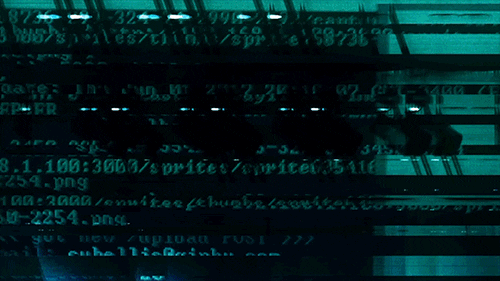

 <h1 align="center">
  
</h1>

  Estudante de programação, interessado em tecnologia e desenvolvimento web, atualmente aprendendo React.

---

  

---

<h2 align="center">🌐 Redes sociais</h2>

  

---

  

<h2 align="center">🎬 Vídeos</h2>

  
  &nbsp;&nbsp;&nbsp;&nbsp;
  

